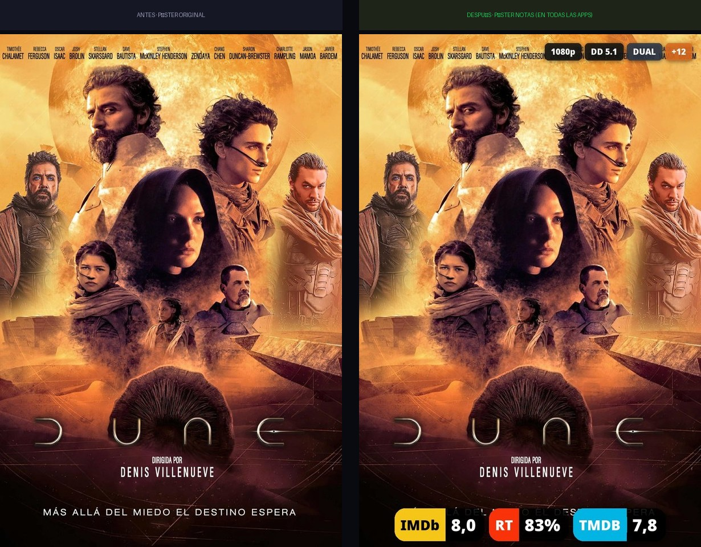
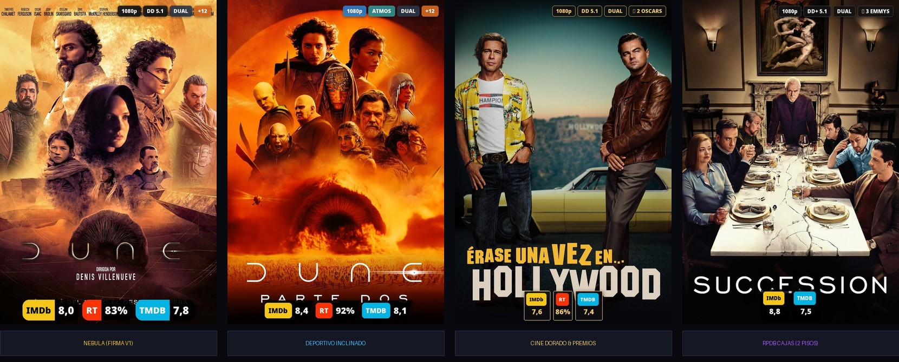
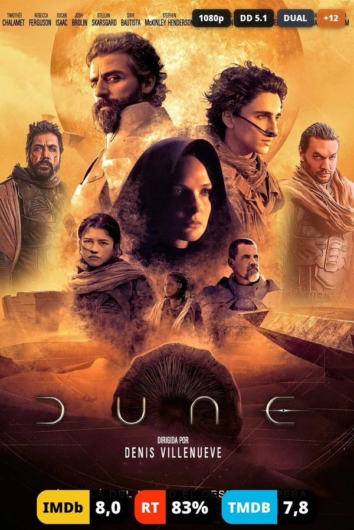
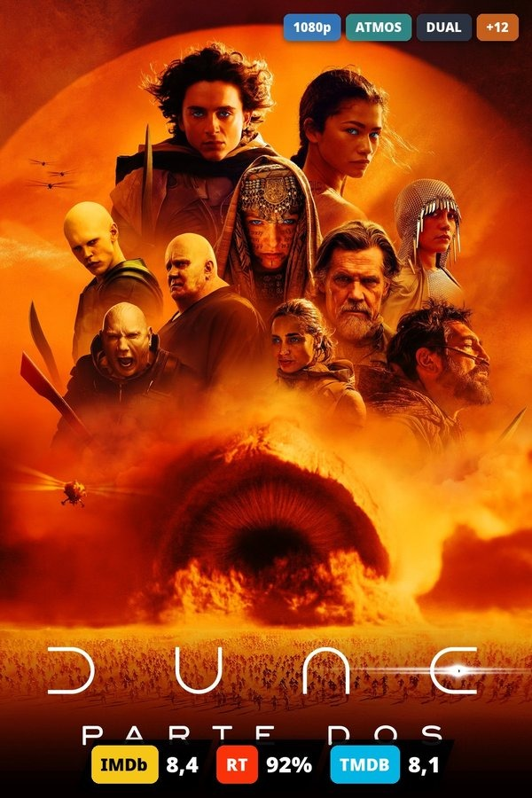
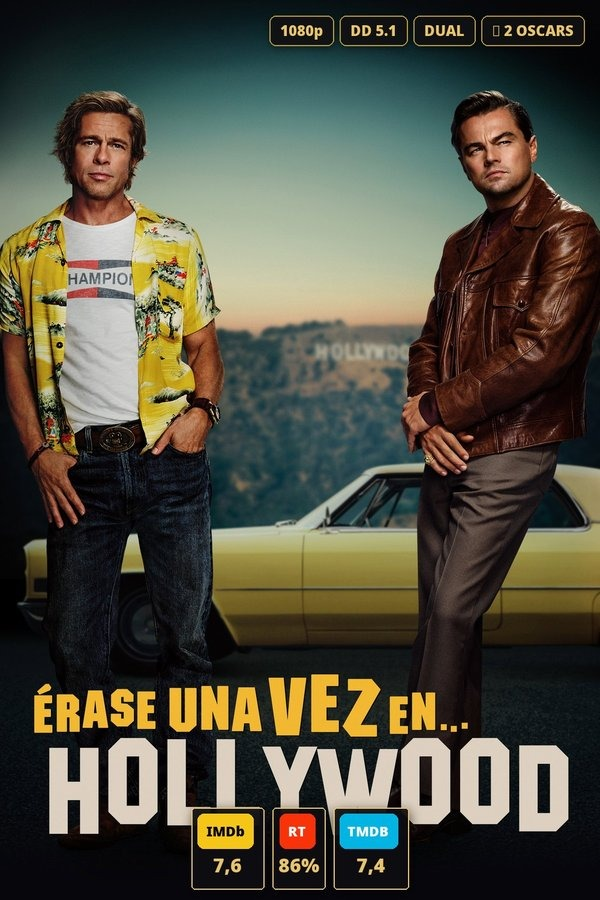
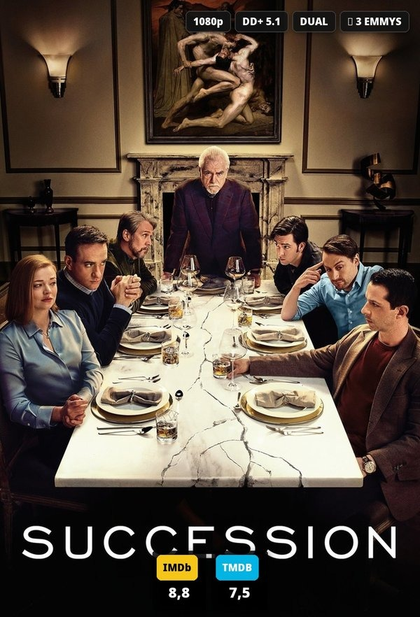

# Póster Notas 🎬

[](https://python.org)
[](https://docker.com)
[](https://emby.media)
[](https://jellyfin.org)
[](https://opensource.org/licenses/MIT)

> Alternativa propia, autónoma y auto-alojada a **RatingPosterDB** (RPDB) para **Emby** y **Jellyfin**.  
> Graba calificaciones fiables (**IMDb, Rotten Tomatoes, TMDB, Metacritic, Trakt, Letterboxd...**) e insignias técnicas de calidad (**4K UHD, HDR10+, Dolby Vision, Dolby Atmos, pistas duales en castellano, galardones de cine y edad**) incrustadas directamente en las carátulas primarias de tus películas y series.
>
> Al modificarse la imagen principal, **las notas e insignias se ven en todas las aplicaciones cliente** (Apple TV, Android TV, Smart TV LG webOS, Samsung Tizen, Roku, móvil, tablet y web).

<p align="center">
  
</p>

---

## 🎨 Muestrario de Estilos y Presets

Póster Notas incluye **14 estilos prediseñados** inspirados en RatingPosterDB listos para aplicar con un solo clic, permitiendo además personalización total de colores, inclinación, opacidad y tamaños:

<p align="center">
  
</p>

| Nebula (Firma v1) | Deportivo Inclinado | Cine Dorado & Premios | RPDB Cajas (2 pisos) |
|:---:|:---:|:---:|:---:|
|  |  |  |  |
| *Pastillas dos colores de alta visibilidad* | *Paralelogramo 20° y corte dinámico* | *Negro grafito y oro con galardones de cine* | *Logotipo arriba y nota grande abajo* |

---

## ✨ Características Principales

- **Calificaciones Precisas y Oficiales**:
  - **IMDb**: Descarga automática diaria del conjunto oficial libre de IMDb (~1,7 millones de obras).
  - **TMDB**: Nota comunitaria directa leída de la biblioteca de tu servidor (`CommunityRating`).
  - **Rotten Tomatoes**: Puntuación de la crítica especializada (`CriticRating`).
  - **Metacritic, Letterboxd, Trakt, Roger Ebert, MyAnimeList y MDBList**: Soporte directo mediante clave de MDBList.
  - **Media unificada**: Opción para calcular la media aritmética normalizada sobre 100 de todas las fuentes disponibles.
- **Insignias Técnicas de Calidad Reales**:
  - Extraídas directamente de los flujos de medios del archivo (`MediaStreams`), no inventadas:
    - **Resolución**: 4K UHD, 1080p, 720p, SD.
    - **Rango dinámico**: Dolby Vision, HDR10+, HDR, HLG, DV · HDR.
    - **Audio espacial y códecs**: Dolby Atmos, DTS:X, TrueHD 7.1, DTS-HD MA, DD+ 5.1, DD 5.1, Lossless / FLAC.
    - **Idioma y doblaje**: Detección inteligente de copias en español (🇪🇸), audio dual (`DUAL`) y versión original subtitulada (`VOSE`).
    - **Banderas de país**: Banderas vectoriales integradas (ES, GB, US, JP, FR, IT, DE, KR).
    - **Origen de la copia**: REMUX, BLURAY, WEB-DL, HDTV.
    - **Códec de vídeo**: AV1, H.265 (HEVC), H.264.
    - **Edición**: Montaje del director, Versión extendida, Sin censura, Remaster, Criterion.
    - **Calificación por edad**: Clasificaciones internacionales (+18, +16, +12, +7, TP, PG-13, R...).
    - **Premios y Galardones de Cine**: Consulta directa a Wikidata (vía SPARQL) con reconocimiento de Óscars (ej. `🏆 2 OSCARS`), Premios Goya, Premios Emmy, Palma de Oro de Cannes, Premios BAFTA y Globos de Oro.
- **Estudio de Diseño Unificado en el Panel Web (`:8790`)**:
  - Todo se ajusta desde **una única pestaña de Diseño**: presets, temas, mapa visual de posición, formato de notas e insignias.
  - **14 Estilos prediseñados (Presets)** listos para usar en un clic (*Nebula*, *Bloques*, *Cajas 2 pisos*, *Deportivo Inclinado*, *Cine Dorado*, *Minimalista*...).
  - Previsualización en pantalla partida con deslizador interactivo en tiempo real **Antes / Después**.
  - Mapas interactivos con 10 posiciones para la barra de notas y 6 para las insignias, con **prevención automática de colisiones**.
  - Estilo **Deportivo Inclinado** nítido con paralelogramos vectoriales en alta definición.
  - Sombra y relieve 3D para garantizar total legibilidad sobre fondos claros o pósters complejos.
- **Seguridad y Reversibilidad 100%**:
  - Cada carátula original se preserva automáticamente en `/data/originales/<servidor>/<id>.jpg` antes de cualquier modificación.
  - **Botón de reversión individual** y **botón de restauración total de la biblioteca** con 1 clic.
  - Procesamiento seguro por tandas: prueba con 10 títulos antes de aplicar al resto.
  - Detección de cambios manuales: si cambias un póster a mano en Emby o Jellyfin, se toma automáticamente como nuevo original.

---

## 🚀 Instalación Rápida

### Opción 1: Docker CLI (Recomendado)

```bash
docker run -d \
  --name posternotas \
  --restart unless-stopped \
  -p 8790:8790 \
  -e EMBY_URL="http://IP_DE_TU_SERVIDOR:8096" \
  -e EMBY_KEY="tu_api_key_de_emby" \
  -e JELLYFIN_URL="http://IP_DE_TU_SERVIDOR:8096" \
  -e JELLYFIN_KEY="tu_api_key_de_jellyfin" \
  -e TMDB_KEY="tu_clave_tmdb_opcional" \
  -e MDBLIST_KEY="tu_clave_mdblist_opcional" \
  -v /ruta/a/tu/data:/data \
  -v /usr/share/fonts/TTF:/fonts:ro \
  posternotas:latest
```

> [!TIP]
> Si tienes el código fuente descargado, puedes construir la imagen localmente en 10 segundos:
> ```bash
> cd app && docker build -t posternotas:latest .
> ```

---

### Opción 2: Docker Compose (`docker-compose.yml`)

Crea un archivo `docker-compose.yml`:

```yaml
version: "3.8"

services:
  posternotas:
    image: posternotas:latest
    build:
      context: ./app
      dockerfile: Dockerfile
    container_name: posternotas
    restart: unless-stopped
    ports:
      - "8790:8790"
    environment:
      # URLs de tus servidores multimedia (ajusta a tus IPs locales)
      - EMBY_URL=http://192.168.1.100:8096
      - EMBY_KEY=tu_api_key_de_emby
      - JELLYFIN_URL=http://192.168.1.100:8096
      - JELLYFIN_KEY=tu_api_key_de_jellyfin
      # Claves externas opcionales
      - TMDB_KEY=tu_clave_tmdb
      - MDBLIST_KEY=tu_clave_mdblist
    volumes:
      - ./data:/data
      - /usr/share/fonts/TTF:/fonts:ro
```

Inicia el servicio:
```bash
docker compose up -d
```

---

### Opción 3: Unraid

1. Ve a la pestaña **Docker** en Unraid y pulsa **Añadir contenedor**.
2. Rellena los campos básicos:
   - **Nombre**: `posternotas`
   - **Repositorio**: `posternotas:latest` (o construye desde Dockerfile en `/mnt/user/appdata/posternotas/app`)
   - **Puerto**: `8790` (Host) -> `8790` (Contenedor)
   - **Ruta de datos**: `/mnt/user/appdata/posternotas/data` mapeada a `/data`
   - **Ruta de fuentes**: `/usr/share/fonts/TTF` mapeada a `/fonts:ro`
3. Añade las variables de entorno (`EMBY_KEY`, `JELLYFIN_KEY`, `TMDB_KEY`, `EMBY_URL`, `JELLYFIN_URL`) o monta un archivo `.env` en `/config/posternotas.env:ro`.
4. Pulsa **Aplicar**.

---

## 🔑 Variables de Entorno y Claves

| Variable | Descripción | Obligatoria |
|---|---|:---:|
| `EMBY_URL` | URL base de tu servidor Emby (ej. `http://192.168.1.100:8096`). | Solo si usas Emby |
| `EMBY_KEY` | Clave API generada en Emby (*Configuración -> Avanzado -> Claves de API*). | Solo si usas Emby |
| `JELLYFIN_URL` | URL base de tu servidor Jellyfin (ej. `http://192.168.1.100:8096`). | Solo si usas Jellyfin |
| `JELLYFIN_KEY` | Clave API generada en Jellyfin (*Panel de control -> Avanzado -> Claves de API*). | Solo si usas Jellyfin |
| `TMDB_KEY` | Clave API gratuita de TheMovieDB (para carátulas limpias sin texto o por idioma). | Opcional |
| `MDBLIST_KEY` | Clave de MDBList (necesaria para Metacritic, Letterboxd, Trakt y Roger Ebert). | Opcional |
| `PN_DATA` | Ruta interna de almacenamiento de datos y pósters originales (por defecto `/data`). | No |
| `PN_FONTS` | Ruta interna con fuentes TrueType Noto Sans (por defecto `/fonts`). | No |
| `PN_ENV` | Ruta alternativa de un archivo `.env` para no pasar claves en texto plano. | No |

> [!NOTE]
> También puedes montar un archivo `.env` en cualquiera de las siguientes rutas dentro del contenedor: `/config/posternotas.env`, `/config/.env` o `/data/.env`. Póster Notas detectará las claves automáticamente.

---

## 📖 Guía de Uso Paso a Paso

1. **Accede al panel web**:  
   Abre en tu navegador `http://TU_SERVIDOR:8790`.
2. **Personaliza el diseño en la pestaña `🎨 Diseño`**:  
   - Selecciona uno de los **14 estilos prediseñados** o crea el tuyo propio.
   - Elige la posición de las calificaciones en el mapa visual (arriba, abajo, centro o columnas laterales).
   - Ajusta formato (`7,4 · 75%`, `Sobre 100`, `Sin sufijos`), decimales con coma, tamaño y opacidad.
   - Activa las insignias que prefieras (4K, HDR, Dolby Vision, audio, idioma, premios de cine y edad).
3. **Compara en vivo con la Vista Previa**:  
   - Busca cualquier película o serie de tu catálogo en la columna derecha.
   - Mueve el deslizador **Antes / Después** para apreciar exactamente el resultado final antes de tocar nada.
4. **Prueba de seguridad**:  
   - Ve a la pestaña **`🚀 Aplicar`** y pulsa **`🧪 Probar con 10 títulos`**.
   - Abre tu cliente de Emby o Jellyfin (en el televisor o en el móvil) y confirma que te agrada cómo lucen las carátulas.
5. **Aplicación por tandas o automatización**:  
   - Puedes aplicar tandas de 50 títulos, la biblioteca completa, o programar una pasada automática nocturna en la pestaña **`⚙️ Ajustes`**.
6. **Reversibilidad**:  
   - Si en algún momento deseas volver al póster original de cualquier título, pulsa **Revertir**. Si deseas deshacer todas las carátulas de la biblioteca, pulsa **`↩ Revertir TODO`**.

---

## 📁 Estructura del Repositorio

```text
posternotas/
├── app/
│   ├── app.py          # Servidor Flask y endpoints REST (:8790)
│   ├── motor.py        # Lógica de notas, insignias, Wikidata, Emby/Jellyfin y lotes
│   ├── render.py       # Motor gráfico de dibujo vectorial en Pillow
│   ├── panel.html      # Panel web interactivo con diseño unificado
│   └── Dockerfile      # Imagen optimizada basada en python:3.12-slim
├── data/               # Directorio persistente montado en /data
│   ├── config.json     # Ajustes configurados por el usuario
│   ├── posternotas.sqlite  # Base de datos SQLite (caché de IMDb, premios y firmas)
│   └── originales/     # Copias de seguridad de las carátulas originales
├── docs/assets/        # Capturas y carátulas de demostración
└── README.md
```

---

## 🔌 Referencia de la API REST

| Método | Endpoint | Descripción |
|---|---|---|
| `GET` | `/` | Interfaz web del panel de administración |
| `GET` | `/api/meta` | Catálogo de fuentes, temas, presets y estado de MDBList |
| `GET` | `/api/config` | Configuración activa en JSON |
| `POST` | `/api/config` | Guarda nuevos ajustes de diseño y servidores |
| `POST` | `/api/config/reset` | Restablece los ajustes a los valores de fábrica |
| `GET` | `/api/buscar?srv=emby&q=Dune` | Busca títulos en la biblioteca de Emby o Jellyfin |
| `GET` | `/api/preview?srv=emby&id=123&w=860` | Genera vista previa dinámica en tiempo real |
| `GET` | `/api/original?srv=emby&id=123` | Devuelve el póster original sin notas |
| `GET` | `/api/detalle?srv=emby&id=123` | Devuelve notas e insignias técnicas leídas del archivo |
| `POST` | `/api/aplicar` | Lanza pasada en lote (`limite`, `buscar`, `forzar`) |
| `POST` | `/api/aplicar_uno` | Aplica notas a un único título seleccionado |
| `POST` | `/api/revertir` | Restaura el póster original (`srv`, `id`) o de toda la biblioteca (`todo: true`) |
| `GET` | `/api/estado` | Estado de tareas en segundo plano, progreso y log en vivo |

---

## ❓ Preguntas Frecuentes (FAQ)

### ¿Se modifican las bases de datos internas de Emby o Jellyfin?
**No**. Póster Notas jamás edita archivos SQLite internos de tus servidores multimedia. Todas las interacciones se realizan exclusivamente a través de las APIs oficiales REST (`POST /Items/{id}/Images/Primary`).

### ¿Qué ocurre si cambio una carátula manualmente en Emby o Jellyfin?
Póster Notas comprueba la firma de la imagen (`ImageTags`). Si detecta que has cambiado el póster manualmente en el servidor, adoptará esa nueva imagen como el póster original de respaldo.

### ¿Se requiere conexión a Internet para funcionar?
Solo para:
1. La descarga inicial del fichero de notas de IMDb (una vez al día).
2. La consulta de premios a Wikidata (si está activada la insignia de premios).
3. La consulta a MDBList (si dispones de clave para fuentes adicionales).
Todo el análisis técnico de pistas de vídeo, audio, HDR y resoluciones se realiza de forma 100% local sobre tu propia biblioteca.

---

## 📄 Licencia

Este proyecto está bajo licencia [MIT](LICENSE). Siéntete libre de utilizarlo, modificarlo y compartirlo con la comunidad.
